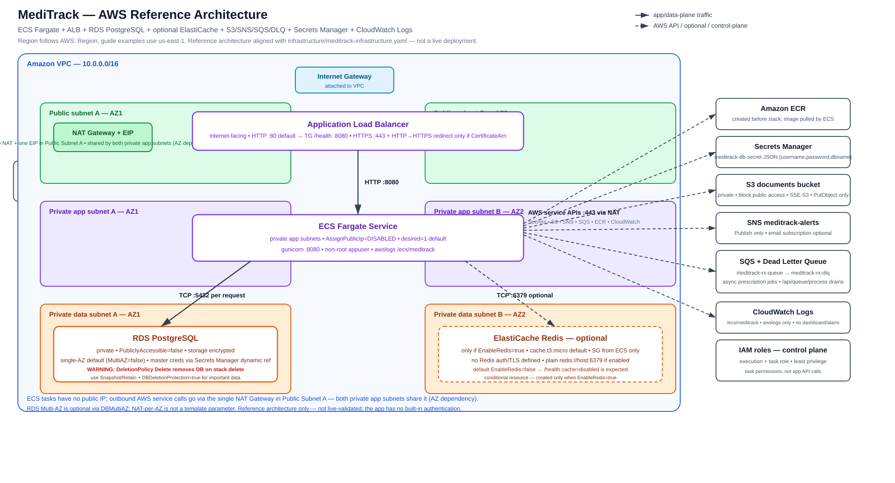

# MediTrack — Clinic Application (Flask)

The application repository **provided** for the MediTrack Cloud Jam (LKS 2027 City Level).
**You do not need to change this code.** Your task: build the image, push it to ECR, and
deploy it to ECS Fargate, then wire it to AWS services via environment variables.

The module questions and challenges are available in the Jam platform after you
press Start and pass the AI pre-check; they are not included in this repository. Source files and the Dockerfile are at the
repository root. Write your own CloudFormation infrastructure from the first
resource; no infrastructure solution, validator, clue or judge tooling is supplied.
Use synthetic data only, and never commit credentials or completed competition solutions.

## AWS Architecture

The following diagram illustrates the proposed AWS infrastructure for deploying MediTrack using Amazon ECS Fargate and AWS managed services.



**Architecture components:**

- Application Load Balancer
- Amazon ECS Fargate
- Amazon ECR
- Amazon RDS PostgreSQL
- AWS Secrets Manager
- Amazon S3
- Amazon SQS and Dead Letter Queue
- Amazon SNS
- Amazon CloudWatch Logs
- Amazon VPC, public/private subnets, and NAT Gateway
- Amazon ElastiCache Redis (optional)

> **Note:** This is a reference architecture aligned with the
> CloudFormation template. It has not yet been validated through
> a complete live AWS deployment. See [AWS Deployment Guide](docs/AWS_DEPLOYMENT_GUIDE.md) and [CloudFormation Template](infrastructure/meditrack-infrastructure.yaml).

## Environment variables (set in the ECS task definition)

| Variable | Value |
|----------|-------|
| `DB_SECRET_ARN` | Secrets Manager ARN `meditrack-db-secret` (JSON: username, password, dbname) |
| `DB_HOST` | RDS PostgreSQL endpoint |
| `CACHE_HOST` | ElastiCache Redis primary endpoint; optional at runtime |
| `DOCS_BUCKET` | S3 documents bucket name |
| `SNS_TOPIC_ARN` | SNS ARN `meditrack-alerts` |
| `RX_QUEUE_URL` | SQS prescription queue URL |
| `AWS_REGION` | `us-east-1` |
| `PORT` | `8080` (default) |

## Endpoints

| Method | Path | Purpose |
|--------|------|---------|
| GET | `/health` | Health check for the ALB (200 when the DB is connected) |
| GET | `/` | Dashboard |
| GET/POST | `/api/patients` | List / add patients |
| GET/POST | `/api/appointments` | List / create appointments (sends SNS) |
| POST | `/api/documents` | Upload a document (to S3) |
| GET | `/api/queue/stats` | Inspect prescription queue depth |
| POST | `/api/queue/process` | Process a batch of prescription jobs |

## Build & run locally (optional, for testing)

```bash
pip install -r requirements.txt
# needs DB_* env vars pointing at Postgres; for local testing you can use a postgres container
python app.py            # serves on :8080
```

## Deployment boundary

Use the supplied Dockerfile to build the application image. Provision the registry,
publish your image and configure the ECS deployment according to the module questions in the Jam platform after passing the AI pre-check. AWS resource deployment commands and completed infrastructure
templates are intentionally not provided here.
