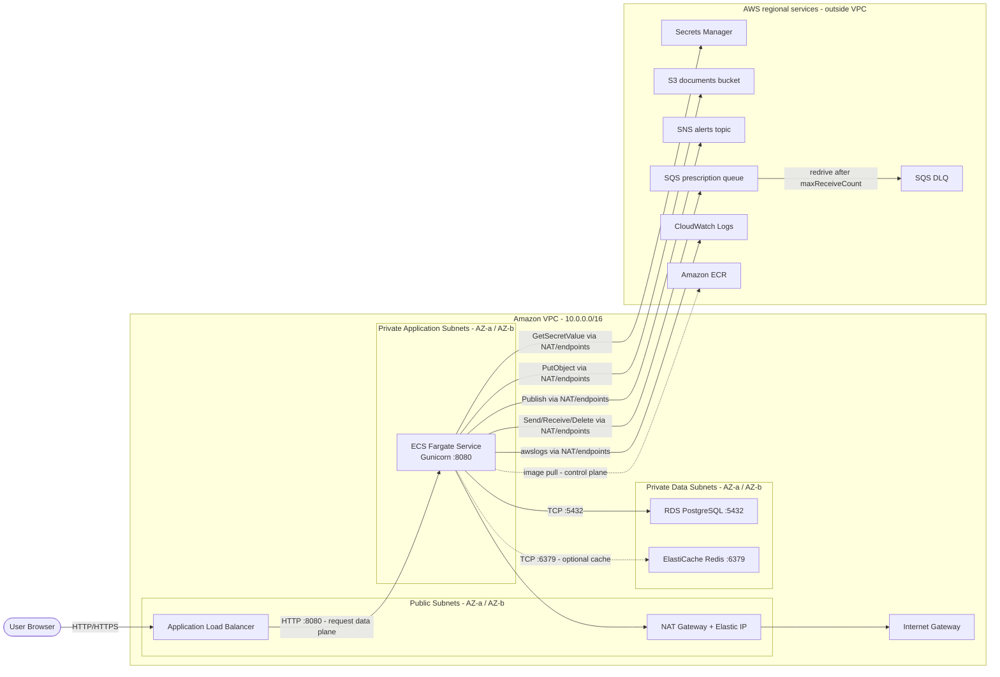

# MediTrack — AWS Cloud Architecture & Deployment Guide

Dokumen ini adalah panduan implementasi untuk repository `meditrack-main` (aplikasi Flask `MediTrack`) ke AWS ECS Fargate di region `us-east-1`.

> Catatan scope: module questions/competition requirements berada di Jam platform dan tidak ada di repository. Dokumen ini hanya memakai requirement yang **terbukti dari source code**. Komponen yang sifatnya opsional/ asumsi ditandai eksplisit.
>
> Status template: **reference implementation**. Ia belum divalidasi melalui complete live AWS deployment; perlakukan sebagai draft untuk deploy Jam, bukan production-ready.

---

## 1. Repository reconnaissance

### 1.1 File inventory

| File | Peran | Temuan penting |
|---|---|---|
| `README.md` | Instruksi deploy untuk peserta | Menyebut environment variables, endpoint, dan bahwa infrastruktur harus ditulis sendiri. Tidak berisi template infra. |
| `app.py` | Aplikasi Flask utama | Membaca env var AWS, mengambil DB credential dari Secrets Manager, memakai psycopg2, Redis opsional, S3, SNS, SQS. |
| `Dockerfile` | Image container | `python:3.12-slim`, install `requirements.txt`, copy source, run sebagai `appuser`, expose `8080`, start `gunicorn -w 2 -b 0.0.0.0:8080 app:app`. |
| `requirements.txt` | Dependency Python | `Flask==3.0.3`, `gunicorn==22.0.0`, `psycopg2-binary==2.9.9`, `boto3==1.34.131`, `redis==5.0.7`. |
| `templates/index.html` | UI dashboard | Memanggil `/health`, `/api/stats`, `/api/patients`, `/api/appointments`, `/api/inventory`, `/api/inventory/<id>/dispense`. |

Catatan inventory: repository `Cloud-Kids/mt` saat ini **tidak memiliki** `.dockerignore` atau `.gitignore`. Jika file tersebut ditambahkan nanti, pastikan mengecualikan `.env*`, `.aws/`, `*.pem`, `*.key`, credentials, dan file secrets agar tidak ikut masuk image/git.

### 1.2 Environment variables yang benar-benar dibaca aplikasi

Dari `app.py:60-66`:

| Variable | Wajib? | Dipakai untuk | Bukti |
|---|---:|---|---|
| `AWS_REGION` | Tidak (default `us-east-1`) | Region untuk boto3 clients | `app.py:60`, `68-71` |
| `DB_HOST` | Ya untuk DB | Endpoint RDS PostgreSQL, port hardcoded `5432` | `app.py:61`, `89-93` |
| `DB_SECRET_ARN` | Ya untuk DB | ARN Secrets Manager berisi JSON `{username,password,dbname}` | `app.py:62`, `78-84` |
| `CACHE_HOST` | Tidak | Endpoint ElastiCache Redis port `6379`; app degrade gracefully jika gagal | `app.py:63`, `97-110` |
| `DOCS_BUCKET` | Hanya untuk fitur dokumen | Bucket S3 untuk upload dokumen | `app.py:64`, `401-406`, `542-549` |
| `SNS_TOPIC_ARN` | Hanya untuk notifikasi | SNS topic untuk alert appointment/low stock | `app.py:65`, `134-139`, `362`, `467`, `538` |
| `RX_QUEUE_URL` | Hanya untuk antrian resep | URL SQS queue untuk prescription jobs | `app.py:66`, `142-151`, `491-539` |
| `PORT` | Tidak untuk Gunicorn | Dipakai hanya jika `python app.py`; Dockerfile menjalankan Gunicorn hardcode `8080` | `app.py:557`, `Dockerfile:24` |

### 1.3 Perilaku startup container

`Dockerfile:24` menjalankan:

```sh
python -c 'import app; app.init_schema()' || true; gunicorn -w 2 -b 0.0.0.0:8080 app:app
```

Implikasi penting:

- `init_schema()` mencoba membuat tabel dan seed data (`app.py:172-229`). Jika gagal, container **tetap start** karena ada `|| true`.
- `/health` mengembalikan `503` sampai DB dan Secrets Manager bisa diakses (`app.py:238-249`). Karena itu ALB target group harus memakai `/health` dan memberi `healthCheckGracePeriodSeconds` yang cukup.
- Gunicorn selalu bind ke `0.0.0.0:8080`. **Jangan set `PORT` lain** kecuali image diubah; container port dan target group harus `8080`.
- Aplikasi berjalan sebagai `appuser` non-root (`Dockerfile:17-19`).
- `boto3` clients dibuat saat module import (`app.py:68-71`), tetapi credential AWS diambil dari task role saat pertama kali dipanggil.
- `_db_cache` menyimpan credential DB per worker process (`app.py:73`, `78-84`). Jika password dirotasi, worker lama dapat tetap memakai credential lama sampai task restart. Karena itu baseline ini memakai secret statis, bukan rotasi otomatis.

### 1.4 Dependency AWS yang terverifikasi

| Kemampuan | Kode | AWS service minimum | Required? | Perilaku jika tidak ada |
|---|---|---|---|---|
| Database | `get_conn()`, `init_schema()`, hampir semua endpoint | RDS PostgreSQL + Secrets Manager | **Wajib** untuk health dan hampir semua endpoint | `/health` 503; endpoint DB error/500 |
| Cache statistik | `cache_get()`, `cache_set()` pada `/api/stats` | ElastiCache Redis | Opsional | `/api/stats` tetap jalan, `_cache` menjadi `miss`/`hit` tidak konsisten; `/health` menampilkan `cache: disabled` |
| Upload dokumen | `POST /api/documents`, `POST /api/records` dengan `document_base64` | S3 bucket + IAM `s3:PutObject` | Wajib hanya jika fitur dokumen dipakai | Endpoint dokumen return 500 jika `DOCS_BUCKET` kosong atau S3 gagal |
| Notifikasi | `notify()` pada appointment, low stock, queue process | SNS topic + IAM `sns:Publish` | Opsional secara runtime, wajib jika modul meminta alert | Error SNS ditelan (`try/except pass`), request tetap sukses tetapi tidak ada notifikasi |
| Antrian resep | `enqueue_rx()`, `/api/queue/stats`, `/api/queue/process` | SQS queue + DLQ + IAM SQS | Wajib jika fitur prescription async dipakai | `POST /api/records` tetap insert prescription tetapi `prescriptions_queued=0`; `/api/queue/process` 500 jika `RX_QUEUE_URL` kosong |
| Logging | Tidak ada app logging khusus | CloudWatch Logs via `awslogs` driver | Operasional | Sulit debugging; task tetap jalan |

### 1.5 Confirmed vs assumptions

**Confirmed dari source code:**

- Flask + Gunicorn, container port `8080`, non-root user.
- PostgreSQL via psycopg2, credential dari Secrets Manager JSON.
- Redis opsional dan tidak memakai auth/TLS di kode.
- S3 hanya `PutObject`.
- SNS hanya `Publish`.
- SQS memakai `SendMessage`, `ReceiveMessage`, `DeleteMessage`, `GetQueueAttributes`.
- Aplikasi tidak punya authentication/authorization.

**Asumsi/rekomendasi baseline (bukan hidden requirement):**

- VPC dengan public/private/data subnets untuk isolasi.
- ALB publik; HTTPS jika `CertificateArn` tersedia, fallback HTTP untuk environment Jam.
- Satu NAT Gateway untuk outbound AWS API calls (cost-efficient); HA penuh bisa pakai NAT per AZ.
- ECS desired count default 1 untuk hemat biaya; naikkan ke 2+ hanya jika butuh HA.
- RDS single-AZ `db.t3.micro` default; Multi-AZ opsional.
- Redis opsional via parameter `EnableRedis` (default `false`); aktifkan hanya jika cache dibutuhkan. Node `cache.t3.micro`, tanpa auth/TLS karena kode aplikasi tidak mendukung.
- SQS standard queue + DLQ dengan `maxReceiveCount=3`.
- CloudWatch Logs retention 30 hari.

---

## 2. Arsitektur AWS yang dibutuhkan

### 2.1 Komponen wajib minimum

Agar aplikasi sehat dan endpoint inti jalan:

1. **VPC** dengan minimal public subnet untuk ALB dan private subnet untuk ECS.
2. **Internet Gateway** untuk ALB inbound.
3. **NAT Gateway atau VPC endpoints** agar ECS task bisa memanggil Secrets Manager, RDS tidak perlu outbound, tetapi ECS perlu AWS APIs.
4. **Security Groups** dengan least privilege.
5. **Application Load Balancer** + **Target Group** health check `/health`.
6. **ECR repository** untuk image.
7. **ECS Cluster** + **Task Definition** + **Service** Fargate.
8. **RDS PostgreSQL** di private data subnet.
9. **Secrets Manager secret** JSON `{username,password,dbname}`.
10. **IAM Execution Role** untuk pull image + tulis logs.
11. **IAM Task Role** untuk Secrets Manager, S3, SNS, SQS.
12. **CloudWatch Logs group**.

### 2.2 Komponen untuk fitur lengkap

Agar semua env var dan endpoint berfungsi:

- **S3 bucket** privat untuk dokumen.
- **SNS topic** `meditrack-alerts` untuk notifikasi.
- **SQS queue** `meditrack-rx-queue` + **DLQ** `meditrack-rx-dlq` dengan redrive policy.
- **ElastiCache Redis** opsional untuk cache `/api/stats`.

### 2.3 Letak network tiap resource

| Resource | Letak | Alasan |
|---|---|---|
| Internet Gateway | VPC level | Entry point inbound untuk ALB dan outbound untuk NAT. |
| ALB | Public subnets, minimal 2 AZ | Perlu IP publik/ELB DNS agar user bisa akses. |
| NAT Gateway | Public subnet | Memberi outbound internet/AWS API untuk private ECS tasks. |
| ECS Fargate tasks | Private application subnets | Tidak perlu IP publik; traffic masuk hanya dari ALB SG. |
| RDS PostgreSQL | Private data subnets, `PubliclyAccessible=false` | Database tidak boleh expose ke internet. |
| ElastiCache Redis | Private data subnets | Cache tidak boleh expose; SG hanya izinkan ECS. |
| S3/SNS/SQS/Secrets Manager/CloudWatch/ECR | AWS regional services di luar VPC | Diakses via AWS API endpoints melalui NAT atau VPC endpoints. |

### 2.4 Security group design

| Security Group | Ingress | Egress | Catatan |
|---|---|---|---|
| `alb-sg` | `80/tcp`, `443/tcp` dari `AllowedHttpSourceCidr` | `8080/tcp` ke VPC CIDR | ALB hanya forward ke ECS pada 8080; ingress ECS tetap dibatasi ke `alb-sg`. |
| `ecs-sg` | `8080/tcp` dari `alb-sg` | DNS `53` ke VPC CIDR, `5432`/`6379` ke VPC CIDR, `443` ke `0.0.0.0/0` via NAT/endpoints | Task tidak boleh diakses langsung dari internet; RDS/Redis ingress hanya menerima dari `ecs-sg`. |
| `rds-sg` | `5432/tcp` dari `ecs-sg` | Egress minimal loopback (menekan default allow-all) | Hanya ECS yang boleh connect. |
| `redis-sg` | `6379/tcp` dari `ecs-sg` | Egress minimal loopback (menekan default allow-all) | Hanya ECS yang boleh connect. |

> Catatan keamanan: aplikasi tidak punya auth. Jika competition mengizinkan, batasi `AllowedHttpSourceCidr` atau tambahkan auth layer di depan ALB. Jangan expose port 8080 langsung.

---

## 3. Topology diagram



### 3.1 Cara membaca diagram

- **Data plane user**: `User -> ALB -> ECS`. ALB me-terminate HTTP/HTTPS lalu forward ke target group port `8080`.
- **Data plane internal**: `ECS -> RDS` dan `ECS -> Redis` tetap di dalam VPC private subnets.
- **AWS API calls**: `ECS -> Secrets/S3/SNS/SQS/CloudWatch` keluar lewat NAT Gateway ke AWS service endpoints, kecuali jika nanti ditambah VPC endpoints.
- **Async pharmacy flow**: aplikasi mengirim job ke SQS; `/api/queue/process` menerima batch, update stock di RDS, lalu delete message. Message yang gagal berulang dipindah ke DLQ oleh redrive policy SQS.
- **Control plane**: `ECR -> ECS` adalah image pull oleh Fargate/ECS agent, bukan request user. CloudFormation/CLI juga merupakan control plane.

---

## 4. Request flow end-to-end

1. Browser resolve ALB DNS name (atau custom domain via Route53 jika dibuat).
2. ALB listener menerima `80` atau `443`.
   - Jika HTTPS: TLS terminate di ALB dengan ACM certificate, lalu forward HTTP ke target group.
   - Jika HTTP only: listener `80` langsung forward.
3. Target group memilih healthy ECS task dan meneruskan request ke port `8080`.
4. Target group health check memanggil `GET /health` secara berkala. Endpoint ini return `200` hanya jika Secrets Manager dan RDS bisa diakses (`app.py:238-249`).
5. Flask/Gunicorn memproses request:
   - Endpoint DB: buka koneksi psycopg2 baru per request.
   - `/api/stats`: coba Redis cache dulu; jika miss, query RDS lalu `cache_set`.
   - `/api/appointments` POST: insert ke RDS lalu `sns.publish`.
   - `/api/records` POST: opsional upload ke S3, insert medical record + prescription, lalu `sqs.send_message` per prescription line.
   - `/api/documents` POST: `s3.put_object`.
   - `/api/queue/stats`: `sqs.get_queue_attributes`.
   - `/api/queue/process` POST: `sqs.receive_message`, update stock di RDS, `sqs.delete_message`.
6. ECS task menulis log ke stdout/stderr; `awslogs` driver mengirim ke CloudWatch Logs.

---

## 5. IAM least privilege

### 5.1 ECS Task Execution Role

Dipakai oleh ECS/Fargate untuk pull image dari ECR dan menulis logs. Tidak dipakai oleh kode aplikasi.

```json
{
  "Version": "2012-10-17",
  "Statement": [
    {
      "Effect": "Allow",
      "Action": [
        "ecr:GetAuthorizationToken",
        "ecr:BatchCheckLayerAvailability",
        "ecr:GetDownloadUrlForLayer",
        "ecr:BatchGetImage",
        "logs:CreateLogStream",
        "logs:PutLogEvents"
      ],
      "Resource": "*"
    }
  ]
}
```

Di CloudFormation, role ini cukup attach managed policy `arn:aws:iam::aws:policy/service-role/AmazonECSTaskExecutionRolePolicy`.

### 5.2 ECS Task Role

Dipakai oleh aplikasi melalui boto3/default credential chain.

```json
{
  "Version": "2012-10-17",
  "Statement": [
    {
      "Sid": "ReadDatabaseSecret",
      "Effect": "Allow",
      "Action": "secretsmanager:GetSecretValue",
      "Resource": "<DB_SECRET_ARN>"
    },
    {
      "Sid": "PutDocuments",
      "Effect": "Allow",
      "Action": "s3:PutObject",
      "Resource": "arn:aws:s3:::<DOCS_BUCKET_NAME>/*"
    },
    {
      "Sid": "PublishAlerts",
      "Effect": "Allow",
      "Action": "sns:Publish",
      "Resource": "<SNS_TOPIC_ARN>"
    },
    {
      "Sid": "UsePrescriptionQueue",
      "Effect": "Allow",
      "Action": [
        "sqs:SendMessage",
        "sqs:ReceiveMessage",
        "sqs:DeleteMessage",
        "sqs:GetQueueAttributes"
      ],
      "Resource": "<RX_QUEUE_ARN>"
    }
  ]
}
```

Catatan:

- App tidak melakukan `s3:GetObject`, `s3:DeleteObject`, `sns:Subscribe`, atau `sqs:PurgeQueue`; jangan berikan permission tersebut.
- DLQ tidak perlu permission aplikasi; redrive dilakukan oleh SQS service.
- Jika memakai customer managed KMS key untuk secret/bucket/topic, tambahkan `kms:Decrypt`/`kms:GenerateDataKey` seperlunya. Baseline memakai AWS managed keys/SSE-S3 agar tidak perlu KMS permission tambahan.
- ElastiCache Redis dibuat tanpa auth token dan tanpa transit encryption karena `app.py:104-106` hanya connect plain `redis.Redis(host, port=6379)`. Isolasi dilakukan lewat private subnet + security group.
- RDS tidak di-force SSL karena `psycopg2.connect()` di `app.py:89-93` tidak mengirim `sslmode`. Isolasi dilakukan lewat private subnet + security group.

---

## 6. Step-by-step implementation guide

Semua placeholder seperti `<ACCOUNT_ID>`, `<REGION>`, `<IMAGE_URI>` harus diganti dengan nilai environment Anda. Jangan commit credential asli.

### Phase 1 — Preparation

| Command | Where | Fungsi | Expected output | Common failure / recovery |
|---|---|---|---|---|
| `aws sts get-caller-identity` | Local shell / CloudShell | Verifikasi AWS account & principal | JSON berisi `Account`, `Arn`, `UserId` | `Unable to locate credentials` → jalankan `aws configure` atau SSO login. |
| `aws configure get region` | Local shell | Cek region default | `us-east-1` atau kosong | Set `aws configure set region us-east-1` atau pakai `--region`. |
| `aws ec2 describe-regions --query 'Regions[?RegionName==`us-east-1`]'` | Local shell | Pastikan region tersedia | Array berisi `us-east-1` | Region typo; gunakan `us-east-1`. |
| `docker version` | Local shell | Pastikan Docker client/server jalan | Client dan Server version | Install/start Docker Desktop atau gunakan EC2 build host. |
| `aws --version` | Local shell | Pastikan AWS CLI v2 | `aws-cli/2.x` | Install AWS CLI v2. |
| `ls -la` / `Get-ChildItem -Force` | Repo root | Inspect file | Terlihat `app.py`, `Dockerfile`, `requirements.txt`, `templates/` | Salah direktori; `cd` ke repo root. |
| `aws ecr describe-repositories --repository-names meditrack --region us-east-1` | Local shell | Cek ECR repo sudah ada atau belum | `Repository` object atau `RepositoryNotFoundException` | Jika not found, lanjut Phase 3. |

Operator IAM idealnya punya permission untuk VPC/EC2, ELBv2, ECS, ECR, RDS, Secrets Manager, S3, SNS, SQS, CloudWatch Logs, dan IAM role creation. Untuk production, gunakan deployment role terpisah; jangan memakai root user.

### Phase 2 — Application containerization

| Command | Where | Fungsi | Expected output | Common failure / recovery |
|---|---|---|---|---|
| `docker build -t meditrack:local .` | Repo root | Build image dari Dockerfile | Build sukses, image `meditrack:local` | Dependency download gagal → cek network/proxy; `requirements.txt` pinned. |
| `docker images meditrack:local` | Local shell | Verifikasi image ada | List image dengan size | Build gagal; perbaiki Dockerfile/requirements. |
| `docker inspect --format '{{.Config.User}}' meditrack:local` | Local shell | Cek non-root user | `appuser` | Jika kosong/root, Dockerfile berubah; jangan deploy. |
| `docker run --rm -p 8080:8080 meditrack:local` | Local shell | Smoke test container start | Gunicorn listen di `0.0.0.0:8080` | Container exit → cek `docker logs`. |
| `curl -i http://localhost:8080/health` | Shell lain | Cek health tanpa AWS env | HTTP 503 JSON `status=unhealthy` | Expected jika belum ada `DB_SECRET_ARN`/`DB_HOST`; membuktikan server jalan. |
| `docker logs <container_id>` | Local shell | Lihat startup log | `init_schema skipped` warning lalu Gunicorn boot | Traceback import/ dependency → rebuild. |

Catatan testing lokal penuh sulit karena aplikasi mengambil credential DB dari Secrets Manager, bukan env `DB_USER`/`DB_PASSWORD`. Untuk smoke test image, cukup pastikan Gunicorn bind 8080 dan container non-root. Full integration test dilakukan setelah deploy ke AWS.

`init_schema()` berjalan di setiap task sebelum Gunicorn start. Schema memakai `CREATE TABLE IF NOT EXISTS` dan seed berada dalam satu transaksi, tetapi untuk cold start multi-task paling aman deploy pertama dengan `DesiredCount=1`, verifikasi `/health`, lalu naikkan desired count.

### Phase 3 — Amazon ECR

| Command | Where | Fungsi | Expected output | Common failure / recovery |
|---|---|---|---|---|
| `aws ecr create-repository --repository-name meditrack --region us-east-1 --image-scanning-configuration scanOnPush=true` | Local shell | Buat repo ECR | JSON `repository` dengan `repositoryUri` | Repo sudah ada → gunakan existing atau nama baru. |
| `aws ecr get-login-password --region us-east-1 \| docker login --username AWS --password-stdin <ACCOUNT_ID>.dkr.ecr.us-east-1.amazonaws.com` | Local shell (bash/Git Bash/PowerShell) | Auth Docker ke ECR | `Login Succeeded` | Credential/docker daemon issue → `aws sts get-caller-identity`, restart Docker. |
| `docker tag meditrack:local <ACCOUNT_ID>.dkr.ecr.us-east-1.amazonaws.com/meditrack:latest` | Local shell | Tag image untuk ECR | Tidak ada output | Salah account/region → cek URI. |
| `docker push <ACCOUNT_ID>.dkr.ecr.us-east-1.amazonaws.com/meditrack:latest` | Local shell | Upload layers ke ECR | Progress push lalu `latest: digest: sha256:...` | `no basic auth credentials` → ulangi login; layer terlalu besar → cek network. |
| `aws ecr describe-images --repository-name meditrack --region us-east-1 --image-ids imageTag=latest` | Local shell | Verifikasi image | JSON berisi `imageDigest`, `imageTags` | Image belum push; ulangi tag/push. |

Simpan output `repositoryUri`/`ImageUri`; akan dipakai sebagai parameter `ImageUri` di CloudFormation.

### Phase 4 — Networking

Implementasi networking dibuat oleh CloudFormation template `infrastructure/meditrack-infrastructure.yaml` (lihat Section 7). Jika ingin inspeksi/manual fallback, resource yang harus ada:

- 1 VPC (`VpcCidr`, default `10.0.0.0/16`)
- 1 Internet Gateway + attachment
- 2 public subnets (untuk ALB + NAT)
- 2 private application subnets (untuk ECS tasks)
- 2 private data subnets (untuk RDS/Redis)
- Public route table → IGW
- Private app route table → NAT Gateway
- Private data route table → local only (tanpa IGW/NAT)
- Elastic IP + NAT Gateway di public subnet pertama
- Security groups `alb-sg`, `ecs-sg`, `rds-sg`, `redis-sg`

| Command | Where | Fungsi | Expected output | Common failure / recovery |
|---|---|---|---|---|
| `aws ec2 describe-vpcs --filters Name=tag:Name,Values=meditrack-vpc` | Local shell | Cek VPC hasil deploy | VPC dengan CIDR `10.0.0.0/16` | VPC belum ada → deploy stack gagal di resource VPC. |
| `aws ec2 describe-subnets --filters Name=tag:Name,Values=meditrack-public-a,meditrack-public-b,meditrack-app-a,meditrack-app-b,meditrack-data-a,meditrack-data-b` | Local shell | Cek subnet | 6 subnets dengan CIDR/AZ benar | Subnet overlap/CIDR salah → perbaiki parameter template. |
| `aws ec2 describe-route-tables --filters Name=vpc-id,Values=<VPC_ID>` | Local shell | Cek routing | Public → IGW, app → NAT, data → local only | ECS tidak bisa AWS API → cek NAT route/association. |
| `aws ec2 describe-security-groups --filters Name=group-name,Values=meditrack-alb-sg,meditrack-ecs-sg,meditrack-rds-sg,meditrack-redis-sg` | Local shell | Cek SG | 4 SG dengan rule sesuai Section 2.4 | ALB unhealthy → cek `alb-sg` egress dan `ecs-sg` ingress. |
| `aws ec2 describe-nat-gateways --filter Name=vpc-id,Values=<VPC_ID>` | Local shell | Cek NAT | State `available` | NAT masih `pending` → tunggu; tagihan NAT per jam. |

### Phase 5 — Database dan Secrets Manager

CloudFormation membuat `AWS::SecretsManager::Secret` dengan `GenerateSecretString` JSON berisi `username`, `dbname`, dan generated `password`. RDS memakai dynamic reference ke secret yang sama, jadi tidak ada password hardcode di template.

Sebelum deploy, validasi versi PostgreSQL yang benar-benar tersedia di `us-east-1` — jangan menganggap major version `16` pasti bisa dibuat di semua account/region:

```bash
aws rds describe-db-engine-versions --engine postgres --region us-east-1 \
  --query "DBEngineVersions[?starts_with(EngineVersion, '16')].EngineVersion" \
  --output text
```

Jika hasil kosong, ganti parameter `DBEngineVersion` ke minor yang tersedia (contoh `16.4`) atau major lain yang didukung.

> Peringatan penghapusan: `DBInstance` memakai `DeletionPolicy: Delete`. Menghapus stack akan **menghapus database beserta datanya**. Untuk data penting, ubah ke `Snapshot`/`Retain` dan set `DBDeletionProtection=true`.

| Resource | Konfigurasi penting |
|---|---|
| `AWS::SecretsManager::Secret` | Name `${ProjectName}-db-secret`; `GenerateSecretString` dengan `username`, `dbname`, `password`; tanpa rotation otomatis agar cocok dengan credential caching aplikasi. |
| `AWS::RDS::DBSubnetGroup` | Private data subnets. |
| `AWS::RDS::DBInstance` | `Engine=postgres`, `PubliclyAccessible=false`, `StorageEncrypted=true`, `DBSubnetGroupName`, `VpcSecurityGroupIds=[rds-sg]`, `MasterUsername`/`MasterUserPassword` via dynamic reference ke secret. |
| Task env | `DB_HOST=<RDS endpoint>`, `DB_SECRET_ARN=<secret ARN>` |

| Command | Where | Fungsi | Expected output | Common failure / recovery |
|---|---|---|---|---|
| `aws rds describe-db-instances --db-instance-identifier meditrack-db --region us-east-1 --query 'DBInstances[0].{Endpoint:Endpoint.Address,Status:DBInstanceStatus,Public:PubliclyAccessible}'` | Local shell | Cek RDS endpoint/status | `Endpoint` berisi DNS, `Status=available`, `Public=false` | `creating` → tunggu; `inaccessible-encryption-credentials` → cek KMS/password. |
| `aws rds describe-db-engine-versions --engine postgres --region us-east-1 --query "DBEngineVersions[?starts_with(EngineVersion, '16')].EngineVersion" --output text` | Local shell | Validasi versi PostgreSQL tersedia | Minimal satu versi `16.x` | Kosong → ganti `DBEngineVersion` ke versi yang tersedia. |
| `aws secretsmanager describe-secret --secret-id meditrack-db-secret --region us-east-1` | Local shell | Cek secret ada | JSON metadata secret | `ResourceNotFoundException` → cek stack events. |
| `aws secretsmanager get-secret-value --secret-id meditrack-db-secret --region us-east-1 --query 'SecretString' --output text \| python -c "import sys,json; d=json.load(sys.stdin); print(sorted(d.keys()))"` | Local shell | Verifikasi key JSON tanpa print password | `['dbname', 'password', 'username']` | Key kurang → perbaiki `SecretStringTemplate`. |

Jangan menampilkan `SecretString` mentah di log/terminal bersama. Gunakan query Python di atas hanya untuk cek key.

### Phase 6 — Supporting AWS services

| Resource | Konfigurasi penting | IAM app |
|---|---|---|
| S3 `meditrack-documents-<account>` | Private, block public access, SSE-S3, task role `s3:PutObject` pada `bucket/*` | `PutObject` saja |
| SNS `meditrack-alerts` | Topic standar; subscription email/SQS opsional lewat parameter `AlertEmail` | `sns:Publish` |
| SQS DLQ `meditrack-rx-dlq` | Retention 14 hari, SSE-SQS | Tidak ada |
| SQS `meditrack-rx-queue` | `VisibilityTimeout=120`, `maxReceiveCount=3`, redrive ke DLQ | `SendMessage`, `ReceiveMessage`, `DeleteMessage`, `GetQueueAttributes` |
| ElastiCache `meditrack-redis` (opsional) | Hanya dibuat jika `EnableRedis=true`; single node `cache.t3.micro`, private data subnet, SG hanya dari ECS, tanpa auth/TLS | Tidak ada IAM khusus; network isolation |

| Command | Where | Fungsi | Expected output | Common failure / recovery |
|---|---|---|---|---|
| `aws s3api get-public-access-block --bucket <DOCS_BUCKET>` | Local shell | Verifikasi bucket privat | Keempat flag `true` | Block public access off → aktifkan; jangan buat bucket public. |
| `aws sns get-topic-attributes --topic-arn <SNS_TOPIC_ARN>` | Local shell | Cek topic ada | Attributes JSON | Topic ARN salah → cek stack output. |
| `aws sqs get-queue-attributes --queue-url <RX_QUEUE_URL> --attribute-names All` | Local shell | Cek queue + redrive | `RedrivePolicy`, `VisibilityTimeout`, ARN | Redrive policy kosong → perbaiki template. |
| `aws sqs get-queue-url --queue-name meditrack-rx-dlq` | Local shell | Cek DLQ | URL DLQ | DLQ belum ada → cek stack events. |
| `aws elasticache describe-cache-clusters --show-cache-node-info` | Local shell | Cek Redis endpoint/status (hanya jika `EnableRedis=true`) | Cluster `meditrack-redis` `CacheClusterStatus=available`, endpoint address | `creating` → tunggu; SG salah → ECS tidak bisa connect; jika `EnableRedis=false`, output kosong dan `cache=disabled` di `/health` adalah expected. |

### Phase 7 — ECS Fargate

CloudFormation membuat:

- `AWS::ECS::Cluster` `meditrack`
- `AWS::Logs::LogGroup` `/ecs/meditrack`
- `AWS::IAM::Role` execution + task roles
- `AWS::ECS::TaskDefinition` dengan image dari parameter `ImageUri`
- `AWS::ElasticLoadBalancingV2::TargetGroup` port `8080`, health check `/health`
- Listener ALB `80` (redirect ke HTTPS jika cert ada) dan `443` jika `CertificateArn` diisi
- `AWS::ECS::Service` Fargate di private app subnets, `AssignPublicIp=DISABLED`, desired count default 1

Environment variables task:

```text
AWS_REGION=<region>
DB_HOST=<RDS endpoint>
DB_SECRET_ARN=<secret ARN>
CACHE_HOST=<Redis endpoint atau kosong jika EnableRedis=false>
DOCS_BUCKET=<bucket name>
SNS_TOPIC_ARN=<topic ARN>
RX_QUEUE_URL=<queue URL>
PORT=8080
```

| Command | Where | Fungsi | Expected output | Common failure / recovery |
|---|---|---|---|---|
| `aws ecs describe-clusters --clusters meditrack --include SETTINGS` | Local shell | Cek cluster | `status=ACTIVE` | Cluster belum ada → cek stack. |
| `aws ecs describe-services --cluster meditrack --services meditrack-app` | Local shell | Cek service | `desiredCount`, `runningCount`, `pendingCount`, load balancer target group | `runningCount < desiredCount` → cek stopped tasks/logs. |
| `aws ecs list-tasks --cluster meditrack --service-name meditrack-app` | Local shell | Ambil task ARN | List task ARN | Tidak ada task → service gagal deploy. |
| `aws ecs describe-tasks --cluster meditrack --tasks <TASK_ARN>` | Local shell | Cek task lastStatus/stoppedReason | `lastStatus=RUNNING` | `stoppedReason` menunjukkan image pull/env/secret error. |
| `aws logs tail /ecs/meditrack --since 10m --region us-east-1` | Local shell | Cek log aplikasi | Gunicorn access/error logs, warning `init_schema` jika DB belum siap | Log kosong → cek log group name/awslogs config. |
| `aws elbv2 describe-target-health --target-group-arn <TG_ARN>` | Local shell | Cek target health | `State=healthy` | `unhealthy` → cek `/health`, SG, task logs. |

### Phase 8 — Application validation

Ganti `<ALB_DNS>` dengan output `LoadBalancerDNSName`.

| Endpoint | Command | Expected |
|---|---|---|
| Health | `curl -i http://<ALB_DNS>/health` | HTTP 200, JSON `status=healthy`, `db=connected`, `cache=connected/disabled`, `queue=enabled` |
| Dashboard | `curl -i http://<ALB_DNS>/` | HTTP 200 HTML dashboard |
| Patients list | `curl -i http://<ALB_DNS>/api/patients` | HTTP 200 JSON `patients` berisi seed data |
| Patient create | `curl -i -X POST http://<ALB_DNS>/api/patients -H 'Content-Type: application/json' -d '{"medical_no":"MRN-TEST-1","full_name":"Test User"}'` | HTTP 201 `id`, `message=patient created` |
| Appointments list | `curl -i 'http://<ALB_DNS>/api/appointments'` | HTTP 200 JSON `appointments` |
| Appointment create | `curl -i -X POST http://<ALB_DNS>/api/appointments -H 'Content-Type: application/json' -d '{"patient_id":1,"doctor_id":1,"scheduled_at":"2026-11-26T09:00:00"}'` | HTTP 201; jika SNS subscriber ada, notifikasi terkirim |
| Documents | `curl -i -X POST http://<ALB_DNS>/api/documents -H 'Content-Type: application/json' -d '{"content_base64":"aGVsbG8="}'` | HTTP 201 `stored=docs/...`; object muncul di S3 |
| Queue stats | `curl -i http://<ALB_DNS>/api/queue/stats` | HTTP 200 `enabled=true`, `available`, `in_flight` |
| Queue process | `curl -i -X POST http://<ALB_DNS>/api/queue/process` | HTTP 200 `received`, `processed`, `low_stock`; butuh message di queue |
| Record + prescription | `curl -i -X POST http://<ALB_DNS>/api/records -H 'Content-Type: application/json' -d '{"patient_id":1,"diagnosis":"test","prescriptions":[{"medicine_id":1,"quantity":1}]}'` | HTTP 201 `prescriptions_queued>=1` jika SQS permission benar |

Catatan: `/api/queue/process` adalah worker manual/endpoint, bukan daemon. Untuk continuous processing, panggil berkala atau buat consumer terpisah sesuai kebutuhan modul.

---

## 7. CloudFormation architecture & resource dependency plan

Template referensi: `infrastructure/meditrack-infrastructure.yaml`.

### 7.1 Parameters utama

| Parameter | Default | Fungsi |
|---|---|---|
| `ProjectName` | `meditrack` | Prefix resource names/tags. |
| `Environment` | `jam` | Tag environment. |
| `VpcCidr` | `10.0.0.0/16` | CIDR VPC. |
| Public/App/Data subnet CIDRs | `10.0.0.0/24`, `10.0.10.0/24`, `10.0.20.0/24` dst. | Jangan overlap. |
| `ImageUri` | required | ECR image URI dari Phase 3. |
| `EcrRepositoryName` | `meditrack` | Nama repo ECR yang sudah dibuat di Phase 3; dipakai untuk output URI. |
| `CertificateArn` | `""` | Jika diisi, ALB buat HTTPS listener + redirect HTTP→HTTPS. |
| `AllowedHttpSourceCidr` | **required** | Wajib diisi CIDR sumber ALB (contoh IP publik `/32` atau CIDR kantor). Jangan pakai `0.0.0.0/0` kecuali app memang sengaja publik. |
| `DesiredCount` | `1` | Jumlah ECS task; naikkan untuk HA setelah budget/needs jelas. |
| `ContainerCpu` / `ContainerMemory` | `512` / `1024` | Resource Fargate task. |
| `DBInstanceClass` / `DBEngineVersion` | `db.t3.micro` / `16` | RDS PostgreSQL; validasi versi tersedia via `describe-db-engine-versions` sebelum deploy. |
| `DBMultiAZ` | `false` | RDS Multi-AZ opsional. |
| `DBDeletionProtection` | `false` | Deletion protection RDS; aktifkan untuk production. |
| `RedisNodeType` | `cache.t3.micro` | ElastiCache node type; hanya dipakai jika `EnableRedis=true`. |
| `EnableRedis` | `false` | Buat ElastiCache Redis. Default nonaktif untuk hemat biaya; aplikasi tetap jalan tanpa cache. |
| `AlertEmail` | `""` | Jika diisi, SNS subscription email dibuat. |

### 7.2 Resource dependency order

```text
Parameters/Conditions
  -> VPC, IGW, EIPs, subnets, route tables, NAT Gateway
  -> Security Groups (ALB, ECS, RDS, Redis)
  -> S3 bucket, SNS topic(+subscription), SQS DLQ -> SQS queue
  -> Secrets Manager DB secret
  -> RDS DB subnet group + DB instance   (depends on secret + data subnets + rds-sg)
  -> ElastiCache subnet group + cache cluster (hanya jika EnableRedis=true; depends on data subnets + redis-sg)
  -> CloudWatch Logs group
  -> ECS execution role + task role + policies
  -> ECS cluster
  -> Target Group
  -> ALB listeners (80 always; 443 if CertificateArn)
  -> ECS Task Definition (depends on image, env endpoints, IAM roles, log group)
  -> ECS Service (depends on cluster, task def, app subnets, ecs-sg, target group)
```

ECR repository sengaja tidak dibuat oleh stack ini: image harus sudah di-push sebelum ECS service dibuat. Buat repo di Phase 3, lalu oper parameter `ImageUri` dan `EcrRepositoryName`.

Dependency penting:

- `RxQueue` `RedrivePolicy` butuh `RxDeadLetterQueue.Arn`; DLQ dibuat dulu.
- `DBInstance.MasterUsername/MasterUserPassword` memakai dynamic reference ke `DBSecret`; `DBSecret` dibuat sebelum RDS.
- `TaskDefinition.Environment` mereferensikan `DBInstance.Endpoint.Address`, `DBSecret`, `DocsBucket`, `AlertTopic`, `RxQueue`; `CACHE_HOST` mereferensikan `RedisCluster.RedisEndpoint.Address` hanya jika `EnableRedis=true` (selain itu bernilai kosong).
- `ECS Service` mereferensikan private app subnets, `ecs-sg`, dan target group.
- ALB listener mereferensikan target group dan optional certificate.
- Untuk menghindari circular dependency, egress `alb-sg`/`ecs-sg` memakai CIDR VPC (`8080`, `5432`, `6379`), sedangkan ingress `ecs-sg`/`rds-sg`/`redis-sg` tetap security-group based; efektif traffic tetap hanya ALB→ECS dan ECS→RDS/Redis. `rds-sg`/`redis-sg` mendapat egress loopback minimal untuk menekan default allow-all egress.
- `DbInstance` memakai `DeletionPolicy: Delete`. **Stack delete akan menghapus database dan datanya.** Untuk environment penting, ganti ke `Snapshot`/`Retain` dan set `DBDeletionProtection=true`; untuk Jam cleanup cepat, `Delete` lebih praktis tetapi tetap berisiko.

### 7.3 Outputs template

- `LoadBalancerDNSName`
- `EcrRepositoryUri`
- `EcsClusterName`, `EcsServiceName`
- `DbEndpoint`, `DbSecretArn`
- `DocsBucketName`
- `AlertTopicArn`
- `RxQueueUrl`, `RxDeadLetterQueueArn`
- `RedisEndpoint` (kosong jika `EnableRedis=false`)
- `LogsGroupName`

### 7.4 Perintah CloudFormation

| Command | Where | Fungsi | Expected output | Common failure / recovery |
|---|---|---|---|---|
| `aws cloudformation validate-template --template-body file://infrastructure/meditrack-infrastructure.yaml` | Repo root | Validasi syntax template | JSON `Parameters`, `Resources` | Syntax/YAML error → perbaiki template. |
| `aws cloudformation deploy --stack-name meditrack --template-file infrastructure/meditrack-infrastructure.yaml --capabilities CAPABILITY_NAMED_IAM --region us-east-1 --parameter-overrides ImageUri=<ACCOUNT_ID>.dkr.ecr.us-east-1.amazonaws.com/meditrack:latest AllowedHttpSourceCidr=<YOUR_PUBLIC_IP>/32` | Repo root | Deploy/update stack | `Successfully created/updated stack` | Rollback → `aws cloudformation describe-stack-events --stack-name meditrack` cari resource `CREATE_FAILED`. |
| `aws cloudformation describe-stacks --stack-name meditrack --query 'Stacks[0].Outputs'` | Local shell | Ambil outputs | ALB DNS, queue URL, dsb. | Stack masih `CREATE_IN_PROGRESS` → tunggu. |
| `aws cloudformation describe-stack-events --stack-name meditrack --max-items 50` | Local shell | Debug kegagalan | Event resource status/reason | `InsufficientCapabilities` → pakai `CAPABILITY_NAMED_IAM`; `ResourceLimitExceeded` → cek quota. |

Jika `CertificateArn` kosong, template membuat HTTP listener `80` forward ke target group. Jika diisi ACM certificate ARN di `us-east-1`, template membuat HTTPS listener `443` dan redirect `80 -> 443`.

---

## 8. Troubleshooting matrix

| Symptom | Possible root cause | Diagnostic command | Solution | Verification |
|---|---|---|---|---|
| ECS task `STOPPED` segera setelah start | Image URI salah/tag belum push | `aws ecs describe-tasks --cluster meditrack --tasks <TASK_ARN>` | Perbaiki `ImageUri`, push ulang image | Task `RUNNING`, `/health` 200 |
| `CannotPullContainerError` / image pull gagal | ECR auth/repo/region salah, execution role kurang | `aws ecr describe-images`, `aws ecs describe-tasks` | Re-login Docker, cek repo URI, attach `AmazonECSTaskExecutionRolePolicy` | Task running, logs ada Gunicorn |
| Target `unhealthy` di ALB | `/health` 503, SG salah, app belum siap | `aws elbv2 describe-target-health`, `aws logs tail /ecs/meditrack` | Cek DB/secret, SG `alb-sg`→`ecs-sg:8080`, naikkan `healthCheckGracePeriodSeconds` | Target `healthy`, curl `/health` 200 |
| `/health` return 503 `db` error | RDS endpoint/secret/SG/DB credentials salah | `aws rds describe-db-instances`, `aws secretsmanager describe-secret`, task logs | Cek `DB_HOST`, `DB_SECRET_ARN`, `rds-sg` ingress dari `ecs-sg`, key JSON secret | `/health` 200 `db=connected` |
| `AccessDeniedException` Secrets Manager | Task role kurang `GetSecretValue` atau secret ARN salah | `aws ecs describe-tasks` + task logs | Update IAM task role policy `secretsmanager:GetSecretValue` pada secret ARN | `/health` tidak error secret |
| `AccessDenied` S3 | Task role kurang `s3:PutObject` atau bucket name salah | `curl POST /api/documents`, task logs | Berikan `s3:PutObject` pada `arn:aws:s3:::bucket/*`; cek `DOCS_BUCKET` | Endpoint return 201 `stored` |
| Redis `cache=disabled` terus | `EnableRedis=false` (expected), `CACHE_HOST` salah, SG `redis-sg`, atau Redis belum available | `aws elasticache describe-cache-clusters`, task logs | Jika `EnableRedis=false`, abaikan. Jika `true`, cek endpoint, SG ingress `6379` dari `ecs-sg`, tunggu cluster `available` | `/health` `cache=connected` saat Redis enabled; `cache=disabled` saat disabled |
| SNS publish tidak sampai | Topic ARN salah, subscription belum confirm, IAM kurang | `aws sns get-topic-attributes`, subscriber email | Cek `sns:Publish`, konfirmasi subscription | Alert email/SQS diterima setelah POST appointment |
| `/api/queue/stats` `enabled=false` | `RX_QUEUE_URL` kosong/salah | `curl /api/queue/stats`, task env | Set env ke queue URL dari stack output | Response `enabled=true` |
| `/api/queue/process` 502/500 | SQS permission, queue URL, atau message malformed | Task logs, `aws sqs get-queue-attributes` | Berikan SQS actions; cek message body JSON | Response `received/processed` |
| Message menumpuk di queue | Worker tidak dipanggil / processing gagal | `aws sqs get-queue-attributes --attribute-names ApproximateNumberOfMessages` | Panggil `/api/queue/process` berkala atau buat consumer; cek DLQ | `ApproximateNumberOfMessages` turun |
| Message masuk DLQ | Processing gagal > `maxReceiveCount` | `aws sqs get-queue-attributes` DLQ, task logs | Perbaiki data/permission; redrive manual jika perlu | DLQ `ApproximateNumberOfMessages=0` |
| DNS/timeout ke AWS APIs dari ECS | NAT route/IGW/SG egress 443 salah | `aws ec2 describe-route-tables`, ECS task logs | Pastikan private app route → NAT, `ecs-sg` egress `443`, NAT `available` | Secrets/S3/SQS call sukses |
| Deploy stack rollback | Resource create gagal | `aws cloudformation describe-stack-events` | Perbaiki parameter/quota/permission lalu `deploy` ulang | Stack `CREATE_COMPLETE` |
| Password DB rotation issue | Menggunakan RDS-managed rotating secret | `aws secretsmanager describe-secret` | Baseline memakai static generated secret; jangan enable rotation otomatis | Koneksi DB stabil > rotation window |

---

## 9. Final verification checklist

- [ ] `aws sts get-caller-identity` menunjuk account yang benar.
- [ ] Region `us-east-1` konsisten di semua perintah.
- [ ] Image `meditrack` ada di ECR dan `ImageUri` benar.
- [ ] Docker image berjalan sebagai `appuser` dan expose `8080`.
- [ ] CloudFormation stack `CREATE_COMPLETE`.
- [ ] VPC/subnet/route/NAT sesuai desain; ECS tasks tidak punya public IP.
- [ ] `AllowedHttpSourceCidr` sudah dibatasi ke IP/CIDR yang diizinkan (bukan `0.0.0.0/0` kecuali memang disengaja).
- [ ] Security groups least privilege; tidak ada `0.0.0.0/0` ke port DB/Redis.
- [ ] RDS `PubliclyAccessible=false`, storage encrypted, endpoint private.
- [ ] `DBEngineVersion` sudah divalidasi tersedia via `describe-db-engine-versions`.
- [ ] `DBInstance` `DeletionPolicy` sudah dipahami; data penting memakai `Snapshot`/`Retain` + `DBDeletionProtection=true`.
- [ ] Secret JSON punya key `username`, `password`, `dbname`.
- [ ] S3 bucket private dan SSE-S3.
- [ ] SNS topic ada; subscription dikonfirmasi jika alert perlu diterima.
- [ ] SQS queue punya redrive policy ke DLQ.
- [ ] Redis endpoint tersedia dan SG hanya izinkan ECS (skip jika `EnableRedis=false`; `/health` `cache=disabled` expected).
- [ ] ECS service `runningCount == desiredCount`.
- [ ] Target group semua `healthy`.
- [ ] `GET /health` return 200 dan `db=connected`.
- [ ] `GET /api/patients` return seed data.
- [ ] `POST /api/patients` return 201.
- [ ] `POST /api/appointments` return 201 dan SNS publish tidak error.
- [ ] `POST /api/documents` return 201 dan object muncul di S3.
- [ ] `GET /api/queue/stats` return `enabled=true`.
- [ ] `POST /api/records` dengan prescription menghasilkan `prescriptions_queued>0`.
- [ ] `POST /api/queue/process` mengurangi stock dan menghapus message.
- [ ] CloudWatch Logs `/ecs/meditrack` berisi request/error logs.
- [ ] Tidak ada credential/password asli di repo, template, atau logs.

---

## 10. Catatan reproduksi mandiri

Untuk reproduce deployment:

1. Siapkan AWS CLI + Docker.
2. Build image dari repository root.
3. Push image ke ECR `meditrack`.
4. Deploy `infrastructure/meditrack-infrastructure.yaml` dengan parameter minimum `ImageUri` dan `AllowedHttpSourceCidr` (opsional: `EnableRedis=true`, `CertificateArn`, `AlertEmail`, `DesiredCount`, `DBMultiAZ`, `DBDeletionProtection`).
5. Ambil `LoadBalancerDNSName` dari stack outputs.
6. Jalankan validation checklist endpoint.
7. Jika butuh HTTPS, request/buat ACM certificate di `us-east-1` dan deploy ulang dengan `CertificateArn`.
8. Jika butuh HA lebih kuat, naikkan `DesiredCount`, aktifkan `DBMultiAZ`, dan pertimbangkan NAT Gateway per AZ.

Template sengaja tidak mengaktifkan rotasi secret otomatis dan tidak mengaktifkan Redis auth/TLS karena kode aplikasi tidak mendukung pola tersebut. Jika module questions meminta encryption/rotation tambahan, itu adalah perubahan requirement yang harus diverifikasi dulu sebelum mengubah aplikasi atau menambah lapisan proxy.
